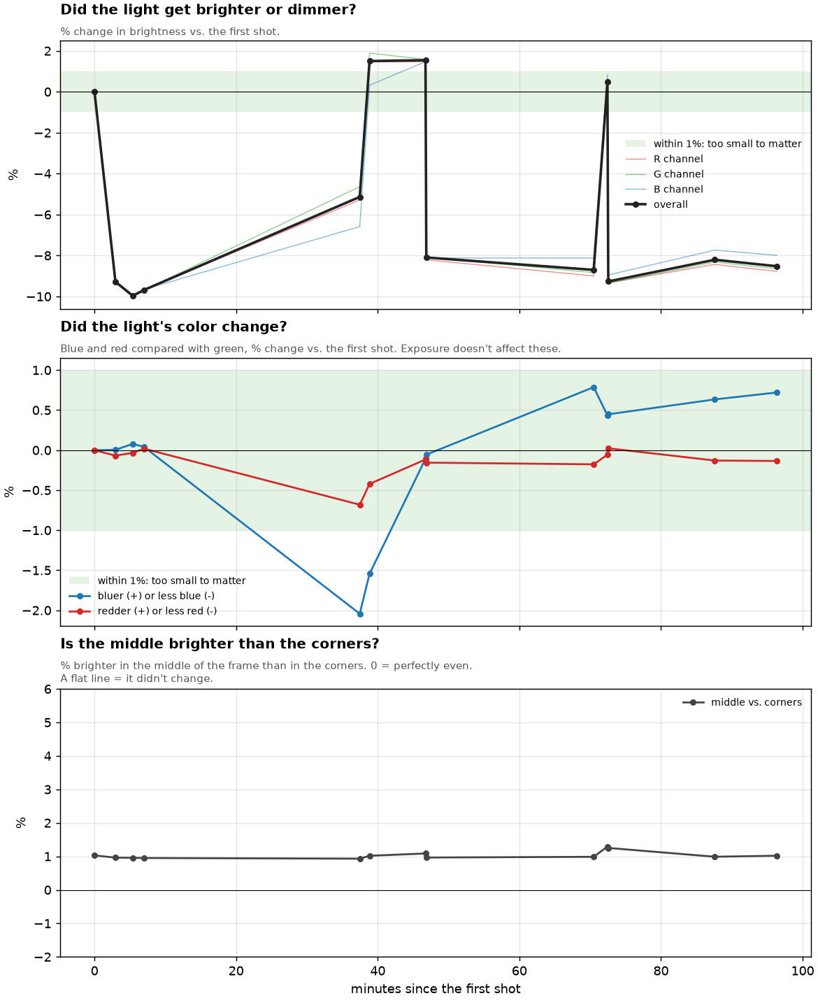
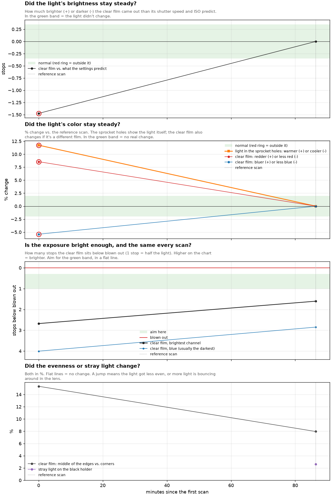

# lightdrift

A small toolkit that tells you if the light you scan film with is any good, using nothing but photos of it taken with your own camera.



## The idea, in plain words

When you scan film with a camera, you put the negative on a light (a light pad, a lightbox, an LED panel) and take a photo of it. The light is the secret ingredient. If it gets dimmer, changes color, or is brighter in the middle than at the edges, your scans won't match each other, and you'll spend hours fixing colors that were never the film's fault.

The problem: your eyes are bad at spotting this. A light that gets 5% dimmer or a tiny bit bluer looks exactly the same to you. Your camera's sensor notices, though. lightdrift reads the raw numbers straight from the sensor and tells you what changed.

Think of it like a thermometer. You don't guess if you have a fever, you measure it.

## What it checks

It has two modes.

**Light check** (the default). You take photos of the bare light, with no film, over an hour or so. It answers:

- **Does it get brighter or dimmer over time?** Like a car engine, a lot of lights need a few minutes to warm up before they settle down.
- **Does its color change?** A light that slowly turns bluer will tint your later scans.
- **Is it even?** Is the middle brighter than the corners?
- **Is anything blown out?** Too bright for the sensor to measure.

**Film check** (`--film`). You give it photos of actual negatives. This one is for "this scan converted weird, was it my light, my exposure, or my conversion?" Every color negative has a strip of clear orange film around the picture. It's the same plastic in every frame, so it should look the same every time. lightdrift uses that strip as a free test patch: if it looks different between two scans, something other than the picture changed.

### What it can't tell you

It measures whether your light is **steady and even**. It can't tell you whether the light has a "good" spectrum (things like CRI). That needs a spectrometer, not a camera.

## What you need

- A camera that shoots raw files (ARW, CR2, CR3, NEF, DNG, RW2, ORF, PEF and friends)
- Python 3 (tested on 3.11)
- The light you want to test

## Install

```sh
git clone https://github.com/davidesqalv/lightdrift.git
cd lightdrift
pip install -r requirements.txt
```

## How to shoot a light check

1. Set up your camera on your scanning rig like you normally would, but with **no film** in the holder.
2. Put the camera in **manual (M)**: fixed shutter speed, aperture and ISO, manual focus. If the settings change between shots, the brightness can't be compared.
3. Expose so the light looks bright but **not blown out**. On the histogram, the hump should sit right of center, not crushed against the right edge.
4. Turn the light on and right away take **two shots back to back**. Those two tell you how much the numbers wiggle on their own, so you know what counts as noise.
5. Then take one shot every 5 to 10 minutes for an hour or so. Don't touch anything in between.
6. Copy the raw files into a folder inside `captures/`, like `captures/my-light/`.

## Run it

```sh
python light_drift.py                      # pick a folder from captures/ from a list
python light_drift.py captures/my-light    # or point straight at one
```

Every run gets its own folder in `light_drift_results/` named after the date and time, so old results never get overwritten.

## What you get back

A `report.txt` written in plain English, with the short answer at the top. Here's a real one: three shots of a light, right after switching it on, then 30 minutes later, then an hour later.

```
THE SHORT ANSWER
  Brightness        CHANGED   Got 5% dimmer by minute 31, then held steady (ended at -6.2%).
  Color             CHANGED   At most 2.7% bluer than the first shot.
  Evenness          OK        The middle and the corners are within 1% of each other, and that
                              didn't change.
  Same settings     OK        Same shutter speed, aperture and ISO in every shot.
  Blown out         OK        Nothing blown out.

  Bottom line: Let the light warm up before scanning. It had settled by minute 31, the first shot
  after the start, so it may need less. Shoot every minute or two at the start to find out. Its
  color shifts too, enough to tint scans slightly.
```

In plain words: this light is perfectly even, but it's a bit like a car on a cold morning. For the first half hour it gets about 5% dimmer and a little bluer, then it settles down. So: switch it on, wait, then scan. The chart at the top of this page is from that same session.

You also get charts:

| File | What it shows |
| --- | --- |
| `over_time.png` | Brightness, color and evenness, shot by shot |
| `uniformity.png` | A map of the frame: which parts are brighter or dimmer than average |
| `level_change.png` | First shot vs. last shot: where it got brighter or dimmer |
| `color_shift.png` | First shot vs. last shot: where the color changed |
| `previews.png` | Every shot, with the differences cranked up so you can see them |
| `results.csv` | All the numbers, for your own spreadsheets |

### What "good" looks like

| Check | Good light |
| --- | --- |
| Brightness | Moves less than 2% once it's warmed up |
| Color | Moves less than 1% (under 2% is still small) |
| Evenness | Middle and corners within 5% of each other, and that doesn't change |

### What the status words mean

| Word | Meaning |
| --- | --- |
| `OK` | Nothing to worry about |
| `SMALL` | It moved, but only a little |
| `CHANGED` | It moved enough to show up in your scans |
| `CHECK` | Worth a look |
| `FIX` | Something in how you shot it needs changing (the report says what) |
| `?` | Not enough information to tell |

## How to use the film check

Scan a roll the way you normally do, but make sure some of the **clear film border** and the **sprocket holes** are in the frame. Then:

```sh
python light_drift.py --film captures/roll1
python light_drift.py --film good.ARW bad.ARW --ref good.ARW   # compare against the scan you like
```

Run it on **one roll at a time**. Different films have different shades of orange.

Here's a real example: a good scan and a bad scan from the same roll, shot 86 minutes apart. lightdrift found that the bad scan came out 1.5 stops darker than its camera settings explain, and the light shining through the sprocket holes was about 12% warmer. So the light itself changed, not the conversion. It also caught that the camera was on auto exposure (so each scan got a different exposure) and that there was room to expose brighter.

Here's the chart from that test. The green bands are the normal range, and anything outside them gets a red circle:



Film mode also gives you `film_check.png`, which shows what it measured in each scan: green is the clear film it used as a test patch, red is bare light through the sprocket holes, blue is the black holder.

## Options

```
--film            film check mode (scans of color negatives)
--ref FILE        film mode: the scan to compare everything against (default: the first negative)
--base L,T,R,B    film mode: where the clear film is, as fractions of the frame, if auto-detect misses it
--order time|given  sort by capture time from the file (default) or keep the order you gave
--grid N          columns in the evenness grid (default 9)
--inset F         margin trimmed off each side of the lit area (default 0.05)
--full-frame      measure the whole frame instead of finding the lit area
--gain N          how much previews.png exaggerates differences (default 5)
--out DIR         where results go (default light_drift_results)
```

---

## Under the hood (the more technical bit)

### Reading the raw file

- Files are opened with [rawpy](https://github.com/letmaik/rawpy) (LibRaw). The per-channel black level is subtracted and each value is divided by `white - black`, so `1.0` means the sensor clipped.
- **No demosaicing, no white balance, no color matrix, no gamma.** Each 2x2 Bayer quad is split into four half-resolution planes and the two greens are averaged. The numbers are the linear sensor response to the light, seen through the camera's own color filters. Nothing about a converter or a camera profile is in them.
- A pixel counts as clipped at 98% of the white level.
- Capture order and the minutes axis come from EXIF `DateTimeOriginal` + `SubSecTimeOriginal` (via exifread). Shutter, aperture, ISO and exposure program come from EXIF too.
- Files are read one at a time and only the measurements plus a downsampled preview are kept, so memory stays low even with dozens of 30 MB raws.

### Light check

- **Finding the lit area.** Luminance is `Y = (R + 2G + B) / 4`. Pixels above half the 99th percentile count as lit. Rows and columns where the lit fraction is over half its maximum give a bounding box, which is then inset by 5% per side (`--inset`). The box comes from the first capture and is reused for every capture, so the exact same pixels are compared every time.
- **Brightness.** The median of each channel over the box, plus `(R + 2G + B) / 4` overall, as % change vs. the earliest capture.
- **Color.** `R/G` and `B/G` of those medians. Because the data is linear, changing exposure scales every channel by the same factor and the ratios don't move. If they change, the light's spectrum (or something else in the light path) changed.
- **Evenness.** The box is split into a grid (`--grid` columns, rows to match the aspect ratio) and the median of each cell is taken. Reported as center cell(s) vs. the mean of the four corner cells, plus the coefficient of variation across cells. This includes the lens's own vignetting, so the *change* over time is more telling than the absolute number. The "what changed" heatmap normalizes each frame by its own mean first, so overall dimming doesn't hide a change in shape.
- **Reading the brightness series.** A total span of 2% or less is `OK`. Three or more steps over 3% in both directions is "jumpy". Otherwise it looks for the first shot after which every remaining shot stays within 1.5% of their median, and reports that as the warm-up time.

### Film check

Each scan is cut into 16x16 blocks (per-channel pixels) and every block is sorted into one of four kinds:

| Kind | How it's found |
| --- | --- |
| Film base | Search area: a band covering the outer 8% of the film, using only orange blocks (`R >= 1.2 * B`) away from bright non-orange ones (bare light). Take the first 4 blocks walking in from each side that sit within 0.5 stops of the brightest film there, then keep those within 0.1 stops of their median brightness and within 3% of their median `R/G` and `B/G`. `--base` overrides this with a box you give. |
| Bare light | More than 0.4 stops brighter than the film base (sprocket holes, gaps around the film) |
| Holder | Dark region connected to the frame edge (flood fill), more than 4.5 stops below the film base |
| Film | Everything else, keeping one block away from bare light to skip the blur around sprocket holes |

A scan whose film base isn't orange (`R/B` under 1.2) is treated as not a color negative and skipped.

Then, for each scan, compared with the reference:

- **Exposure.** Expected change in stops from the settings: `log2(t * ISO / N^2)` (aperture dropped if any file is missing it, e.g. a manual lens). Measured change: `log2(base / base_ref)` of film base luminance. The difference is the **unexplained** part, which is what the light did. Tolerance is 0.15 stops in manual and 0.35 with auto exposure (cameras record rounded shutter speeds).
- **Film base color.** `R/G` and `B/G` of the film base. Flagged past 2%.
- **Light color.** In the sprocket holes, green is usually clipped, so only red and blue are used: pixels over 3x the film base brightness with R and B unclipped, top 20% by brightness, `median(R) / median(B)`. Flagged past 2%. If the film base color moved but the sprocket holes didn't, it's either a different film or the light's green shifted.
- **Headroom.** `-log2(base)` per channel: stops between the film base and clipping. Over 1.5 stops is flagged as underexposed, and it suggests a shutter speed that puts the brightest channel half a stop under clipping, snapped to standard third-stop speeds.
- **Noise.** The 0.5th percentile of the film blocks, in stops below clipping. Past 9 stops it's in the sensor noise floor, and that's the brightest part of the picture once inverted.
- **Evenness.** A least-squares line through `log2(brightness)` vs. `r^2` over the film base ring, where `r^2` is the squared normalized distance from the center (0.5 at the middle of an edge, 1 in a corner). Reported as `2^(-0.5 * slope) - 1`, i.e. how much brighter mid-edge is than the corners. This uses every clear-film block instead of a few corners, so it's much less noisy. Flagged if it changes by more than 5 points.
- **Stray light.** Median holder brightness as % of mean film brightness. Flagged if it rises by more than 0.5 points.

All of these thresholds are named constants near the top of the film section in `light_drift.py` (`COLOR_TOL`, `EXPOSURE_TOL`, `EVEN_TOL`, and so on) if you want to tune them.

### Limits

- **Bayer sensors only.** Fujifilm X-Trans, Foveon and monochrome sensors won't give correct numbers.
- **It measures stability, not spectrum.** It can tell you the color changed. It can't tell you CRI, TLCI or whether the spectrum has gaps.
- **Evenness includes your lens.** Shoot every test at the same aperture if you want to compare lights with each other.
- **Film mode is for color negatives** with an orange mask, one roll per run.
- **Everything is relative** to a reference capture. Absolute numbers depend on your camera.

## What's in the repo

```
light_drift.py      the whole toolkit, one file
requirements.txt    numpy, rawpy, matplotlib, exifread
captures/           put your raw files here, one subfolder per session (ignored by git)
docs/               the example charts in this README
```

## License

MIT
